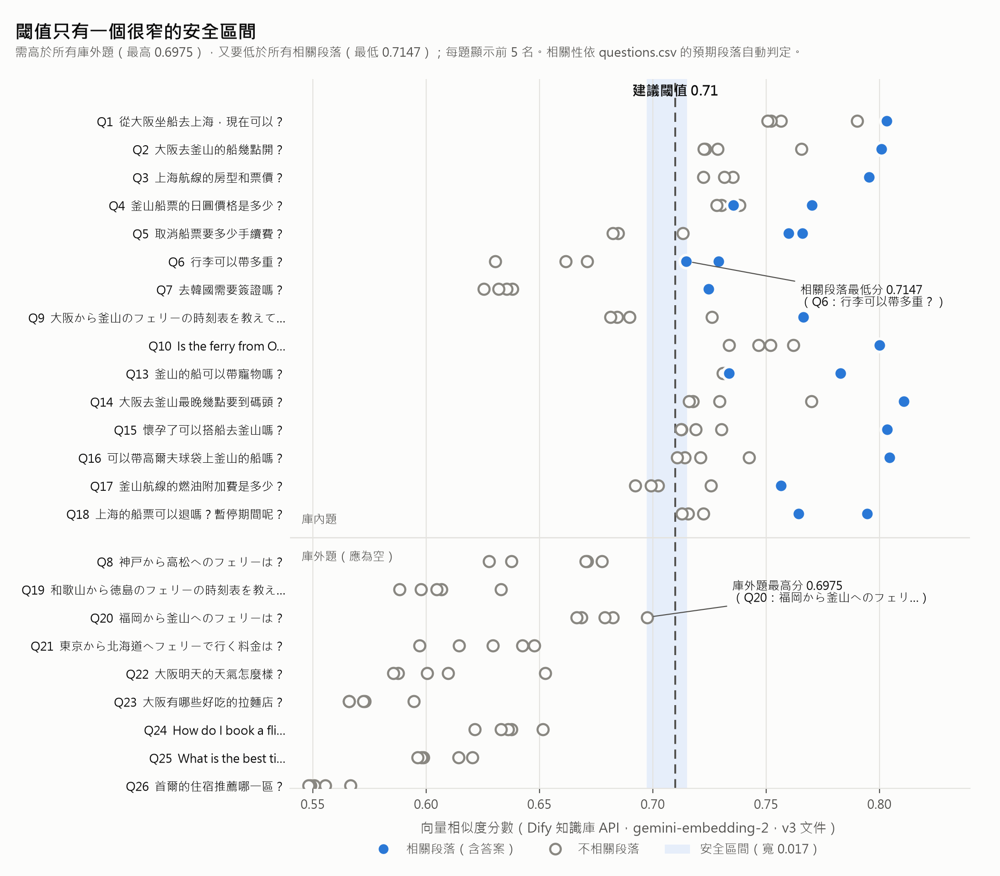
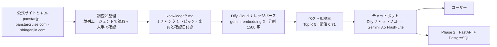
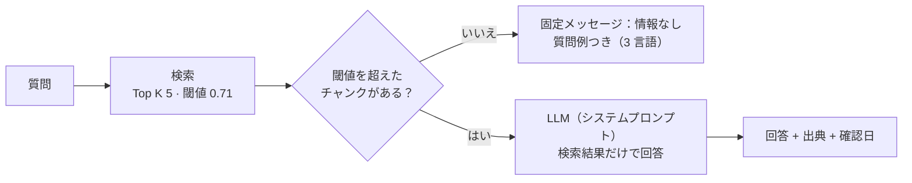

# Japan Ferry KB — 関西発・国際フェリー RAG ナレッジベース

**Dify Cloud** で作った「大阪・神戸発の国際フェリー」案内チャットボットです。目的はチャットボットを作ることそのものではなく、次の点を示すことです：**情報をどう調べ、どう整理し、どうテストし、情報が矛盾・古くなっているときにどうやってボットに間違った回答をさせないか**。

> 中文版：[README.md](README.md)
>
> **状況（2026-11-22）**：Phase 1 進行中。ナレッジベース、検索（リトリーバル）の調整、Dify のチャットボット（Chatflow）、回答レベルの自動テストまでが完了。残りは文書の整理。多言語での回答は一部しか改善しておらず、延期しています。
> 問題と対応の経過は、Jira 形式で [`docs/issues/`](docs/issues/README.md) に 1 件ずつ記録しています（記述は中国語）。
> 詳細な分析は **[第 1 フェーズ RAG データ監査・検索調整レポート](docs/phase1-rag-audit-report.md)**（中国語）を参照してください。

## このプロジェクトで分かったこと

1. **公式情報どうしが矛盾しており、そのままモデルに渡せない。**
   上海航路：公式は 2025-12-08 に「旅客輸送中断」を告知し、再開は未定ですが、公式サイトの運航表には 2027 年 6 月までの便が載ったままで、旅客か貨物かの区別もありません。釜山航路：日本語サイトと韓国語サイトで、取消（払い戻し）規定の数字が一致しません。
2. **価値のある情報が PDF・画像・ページのソースの中に隠れている。** 運賃表の PDF はテキスト層が文字化けしていたため、画像に変換して目視で確認しました。釜山の公式 FAQ は、取得ツールでは「見出しだけ」と判定されましたが、HTML を直接解析して 62 問の回答全文を得ました。
3. **ベクトル検索のスコアでは、答えのない「ヘッダー／見出し」チャンクを見分けられない**（答えのあるチャンクと同じ最大 0.80 まで出る）。解決策は文書構造の変更でした。一方、閾値は「ナレッジベースにない質問」を弾くのに有効です。
4. **検索の閾値は実測で較正する必要があり、安全な範囲は非常に狭い。** この埋め込みモデルのスコアは 0.61〜0.83 に集中するため、閾値なしでは何でも通り、よくある中間値（0.5 など）では何も弾けません。24 問（範囲外 9 問を含む）で較正した結果、「答えを落とさず、範囲外を弾ける」範囲は 0.6975〜0.7147（幅 0.017）しかなく、閾値は 0.71 としました。意味が近い範囲外の質問（例：福岡〜釜山）でも 0.70 が出るため、閾値だけでは防御として不十分です。
5. **パラメータ調整より文書構造の見直しが効く。** 「1 チャンク 1 トピック、見出しに航路ラベル、出典はチャンク内に記載」という構造にした結果、期待回答のある 15 問すべてで関連チャンクが 1 位になり、期待チャンク 21/21 を取得でき、構造的チャンクの混入は 7/26 から 0 になりました。
6. **回答レベルは別にテストし、しかも繰り返しテストする。** 同じ質問・同じ設定でも毎回回答が変わります。スクリプト（`evaluation/run_chat.py`）でチャットアプリ API を繰り返し呼び、ルールで検査します（金額が検索結果に存在するか、禁止表現、出典、運休の状態が冒頭にあるか、など）。例：運賃の回答で「バルコニースイート」の金額が、ナレッジベースにない値になることが時々ありました（約 4/33 回、[FKB-007](docs/issues/FKB-007-nondeterministic-price-hallucination.md)）。出力形式を変えると（客室タイプごとに 1 行、人数は金額の後ろ）20/20 で正しくなりました（サンプルは小さく、証明ではなく裏付けの段階です）。
7. **「テスト設定が本当に有効か」自体を検証する。** 回答に 2 つの出力がつながって出ることがあり、Dify のログを追うと、Google 側の一時的な過負荷 → ノードの再試行 → 途中で切れた前半が残る、という流れでした（[FKB-008](docs/issues/FKB-008-glued-two-generations.md)）。再試行を切ったつもりが、実際には下書きを変えただけで公開していませんでした。Dify の API が動かすのは公開済みのバージョンです。
8. **閾値には代償があり、データで補う（無理に調整しない）。** 閾値 0.71 は「大阪からどこまで行けますか」のような概括的な質問も弾いてしまいます（[FKB-012](docs/issues/FKB-012-overview-questions-miss-threshold.md)）。対策として航路の概要チャンクを追加し、26 問の較正セットを再実行して、安全な範囲（範囲外の最高 0.6975、関連チャンクの最低 0.7147）が変わっていないことを確認しました。



*第 1 回（手動・旧版文書）のスコア分布は [レポート 4.3](docs/phase1-rag-audit-report.md) を参照。*

## アーキテクチャ



## チャットボットの回答フロー



LLM の段階では、システムプロンプトのルールが回答の仕方を決めます（全ルールと根拠は [`chatbot/system-prompt.md`](chatbot/system-prompt.md) を参照）：

| 状況 | 回答の仕方 |
|---|---|
| 旅客輸送が中断している航路（上海） | 最初の一文で中断と再開未定を述べ、この情報は「今購入・乗船できる」ことを意味しないと明記する |
| 公式情報どうしが矛盾（取消料、受付時刻） | 両方を出典つきで並べ、船会社への確認を促す |
| 運賃の質問 | 客室タイプごとに 1 行。金額は検索結果から一字一句そのまま。通貨は元のまま、換算しない |
| 検索結果に書かれていない | 「ない」と答え、推測しない（例：「繁忙期は割引不可」を「繁忙期は値上げ」と言い換えない） |
| 予約・リアルタイム空席・範囲外 | できないと伝え、公式の窓口を案内する |

### 既知の制限

- 日本語・英語の質問に、中国語中心の回答が返ることがまだあります。言語ルールを加えた結果、日英の単一言語の質問で本文の言語が正しかったのは約 8/20（以前は 0/15）、3 言語を 1 つにしたボタンでは約 3/15 です（[FKB-009](docs/issues/FKB-009-answer-language-mismatch.md)。残りは延期。設計の選択肢は [`docs/multilingual-design-options.md`](docs/multilingual-design-options.md)）。
- Gemini の無料枠を使っているため、利用上限や一時的な過負荷がテストに影響します（[FKB-001](docs/issues/FKB-001-gemini-free-tier-quota.md)）。

## 問題の対応状況

| ステータス | 件数 | 項目 |
|---|---|---|
| Done | 4 | FKB-002、003、004、012 |
| Mitigated（暫定対処済み・サンプル小） | 4 | FKB-001、007、008、010 |
| Open | 3 | FKB-006（モデル比較）、009（多言語・延期）、011（テストツールの制限） |
| In Progress | 1 | FKB-005（回答レベルのテスト） |

詳細は [`docs/issues/README.md`](docs/issues/README.md)。数値の誤り（ハルシネーション）への対処レベルと実例は [`docs/hallucination-mitigation-options.md`](docs/hallucination-mitigation-options.md) にあります。

## 対象航路

| 航路 | 運航会社 | 状況（2026-11-21 確認） | ナレッジ文書 |
|---|---|---|---|
| 大阪 ⇄ 釜山 | PANSTAR Cruise Ferry（日本代理店 サンスターライン） | 公式サイトに運休告知なし。最新の時刻表は確認できず | [`knowledge/osaka-busan-panstar.md`](knowledge/osaka-busan-panstar.md) |
| 大阪／神戸 ⇄ 上海 | 日中国際フェリー「鑑真号」 | **旅客輸送を中断中**（公式告知）。公式サイトの運航表は矛盾 | [`knowledge/kansai-shanghai-shinganjin.md`](knowledge/kansai-shanghai-shinganjin.md) |

ほかに、航路の概要をまとめた [`knowledge/overview-routes.md`](knowledge/overview-routes.md) があり、「どんな航路があるか」といった概括的な質問に当たるようにしています。Phase 1 はこの 2 つの国際航路のみで、国内航路（神戸〜高松など）は第 2 フェーズで扱います。

## プロジェクト構成

```text
japan-ferry-kb/
├── README.md / README.ja.md
├── knowledge/                      ナレッジベースの元文書（随時更新）
│   ├── osaka-busan-panstar.md
│   ├── kansai-shanghai-shinganjin.md
│   ├── overview-routes.md          航路の概要（概括的な質問用）
│   └── history/                    過去にアップロード・テストした旧版（テスト記録に対応）
├── chatbot/                        Dify の設定、システムプロンプト（版管理）、開始質問、回答テスト用の質問
├── evaluation/
│   ├── questions.csv          検索テスト用の質問、期待動作、期待チャンク
│   ├── run_recall.py          Dify ナレッジ API で検索テストを実行
│   ├── score_run.py           自動採点と閾値スイープ
│   ├── run_chat.py            チャットアプリ API で回答テストを実行（繰り返し・レート制限対応）
│   ├── score_chat.py          回答のルール検査（金額の裏付け・禁止表現・出典など）
│   ├── chat_runs/             回答テストの実行ごとのフォルダ
│   └── runs/                  検索テストの実行ごとのフォルダ（run-001 は手動、run-002 以降は自動）
└── docs/
    ├── phase1-rag-audit-report.md  監査・調整レポート（中国語）
    ├── dify-setup.md               Dify の設定と再現手順
    ├── sources.md                  情報源と調査記録
    ├── coverage-matrix.md          航路 × トピックの情報カバレッジ
    ├── hallucination-mitigation-options.md  数値ハルシネーションへの対処レベル
    ├── multilingual-design-options.md       多言語設計の選択肢（延期）
    ├── issues/                     問題・改善の記録（Jira 形式、FKB-001〜）
    └── assets/                     図とグラフ生成スクリプト
```

## 再現手順

1. [`docs/dify-setup.md`](docs/dify-setup.md) に従い、モデルプロバイダとナレッジベースを設定します（Gemini API キーは各自で用意。**キーをコミットしないこと**）。
2. `knowledge/` の文書をアップロードします。
3. [`evaluation/questions.csv`](evaluation/questions.csv) を使い、Dify の「検索テスト」で 1 問ずつ確認するか、`evaluation/run_recall.py` で自動実行します。
4. [`chatbot/app-config.md`](chatbot/app-config.md) に従ってチャットフローを作成します（システムプロンプトは [`chatbot/system-prompt.md`](chatbot/system-prompt.md)）。変更後は**必ず「更新を公開」**してください。API が動かすのは公開済みのバージョンです。
5. `.env` に `DIFY_APP_API_KEY` を設定し（`.env.example` を参照）、`python evaluation/run_chat.py` と `score_chat.py` で回答テストを実行します。

## ロードマップ

| フェーズ | 内容 | 状況 |
|---|---|---|
| Phase 1 | ナレッジベース、検索の調整、チャットボットとシステムプロンプト、基本的な評価 | **進行中**（ナレッジベース、検索、チャットボット、回答テストは完了。文書の整理中） |
| Phase 2 | FastAPI で Dify API と連携、PostgreSQL、国内航路のデータ | 未着手 |
| Phase 3 以降 | ワークフロー自動化、人手による確認、品質評価、デプロイ | 詳細未定 |

## データに関する注意

`knowledge/` の内容は、運航会社の公式サイトと告知から本プロジェクトが**まとめた要約**で、確認日は各チャンクの末尾に記載しています。運賃・時刻表・規定は変更されるため、**古くなっている可能性があり、予約や乗船の助言ではありません**。運航会社の公式情報を確認してください。公式の根拠がない項目は一律「未取得」と明記し、推測で補っていません。

ライセンス：未定。
