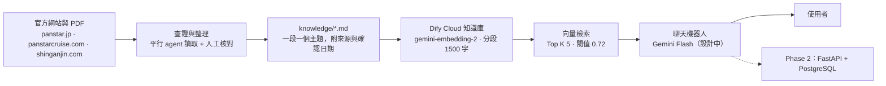
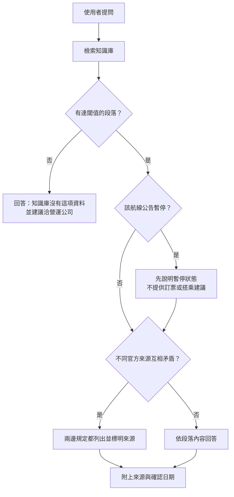

# Japan Ferry KB — 關西出發國際渡輪 RAG 知識庫

以 **Dify Cloud** 建立的「從大阪／神戶出發的國際渡輪」知識庫聊天機器人。重點不只是做出聊天機器人，而是示範：**資料怎麼查證、怎麼整理、怎麼測試、怎麼在資料矛盾或過期時不讓機器人亂答**。

> **狀態（2026-11-21）**：Phase 1 進行中。知識庫已建立並完成第一輪召回測試；聊天機器人（系統提示與回答流程）尚未建立。
> 完整分析見 **[第一階段 RAG 資料稽核與檢索調校報告](docs/phase1-rag-audit-report.md)**。

## 這個專案發現了什麼

1. **官方資料互相矛盾，不能直接餵給模型。**
   上海航線：官方 2025-12-08 公告旅客運送暫停、再開未定，但官網船班表仍列出到 2027 年 6 月的班次，且不區分載客或貨運。釜山航線：日文與韓文兩個官方網站的退票規定數字不一致。
2. **有價值的資訊藏在 PDF、圖片，甚至頁面原始碼裡。** 票價表的文字層是亂碼，必須轉成圖片目視核對；釜山官網 FAQ 的答案被抓取工具判定為「只有標題」，直接解析原始 HTML 才拿到 62 題完整答案。
3. **向量檢索的分數無法分辨「檔頭／標題」這類沒有答案的段落**（它們最高可達 0.80，和答案段落一樣高），只能靠改文件結構解決；但閾值可以擋住「知識庫沒有的題目」。
4. **檢索閾值要靠實測校準**：這個嵌入模型的分數集中在 0.61–0.83，未啟用閾值時所有結果都會通過，常見的中間值（例如 0.5）也擋不住任何東西。先用未啟用閾值的狀態取得完整分數分佈，再校準為 0.72。


## 架構



## 聊天機器人的回答流程（設計目標，尚未實作）



## 目前涵蓋的航線

| 航線 | 營運公司 | 狀態（2026-11-21 確認） | 知識文件 |
|---|---|---|---|
| 大阪 ⇄ 釜山 | PANSTAR Cruise Ferry（日本代理 Sunstar Line） | 官網未見停航公告，無法確認最新班表 | [`knowledge/osaka-busan-panstar.md`](knowledge/osaka-busan-panstar.md) |
| 大阪／神戶 ⇄ 上海 | 日中国際フェリー「鑑真号」 | **旅客運送暫停中**（官方公告），官網班表矛盾 | [`knowledge/kansai-shanghai-shinganjin.md`](knowledge/kansai-shanghai-shinganjin.md) |

Phase 1 只做這兩條國際航線，國內航線（神戶–高松等）留到第二階段。

## 專案結構

```text
japan-ferry-kb/
├── README.md
├── knowledge/                      知識庫來源文件（持續更新）
│   ├── osaka-busan-panstar.md
│   ├── kansai-shanghai-shinganjin.md
│   └── history/                    曾上傳並測試過的舊版本（對應測試紀錄）
├── evaluation/
│   └── test-questions.csv          測試題與預期行為
└── docs/
    ├── phase1-rag-audit-report.md  稽核與調校報告
    ├── dify-setup.md               Dify 設定與重現步驟
    ├── sources.md                  資料來源與查證紀錄
    ├── coverage-matrix.md          航線 × 主題的資料覆蓋盤點
    └── assets/
        ├── retrieval-test-run1.csv 第一輪召回測試原始數據
        ├── make_retrieval_chart.py 由 CSV 產生上圖
        └── retrieval-scores.png
```

## 重現

1. 依 [`docs/dify-setup.md`](docs/dify-setup.md) 設定模型供應商與知識庫（需自備 Gemini API key，**不要提交 key**）。
2. 上傳 `knowledge/` 底下的兩份文件。
3. 用 [`evaluation/test-questions.csv`](evaluation/test-questions.csv) 在 Dify「召回測試」逐題檢查。
4. 重畫圖表：`pip install matplotlib && python docs/assets/make_retrieval_chart.py`

## Roadmap

| 階段 | 內容 | 狀態 |
|---|---|---|
| Phase 1 | 知識庫、召回調校、聊天機器人與系統提示、基本評測 | **進行中**（知識庫與召回測試完成） |
| Phase 2 | FastAPI 串接 Dify API、PostgreSQL、國內航線資料 | 未開始 |
| Phase 3 以後 | 工作流程自動化、人工審核、品質評測、部署 | 未規劃細節 |

## 資料聲明

`knowledge/` 的內容是本專案從營運公司官方網站與公告**整理的摘要**，確認日期見各段落結尾。票價、班次與規定會變動，**可能已過期，不構成訂票或搭乘建議**，請以營運公司官方資訊為準。沒有官方依據的項目一律標示「未取得」，不補編。

授權：尚未決定。
