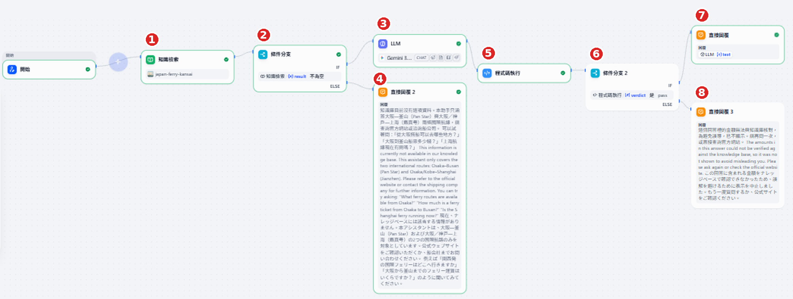
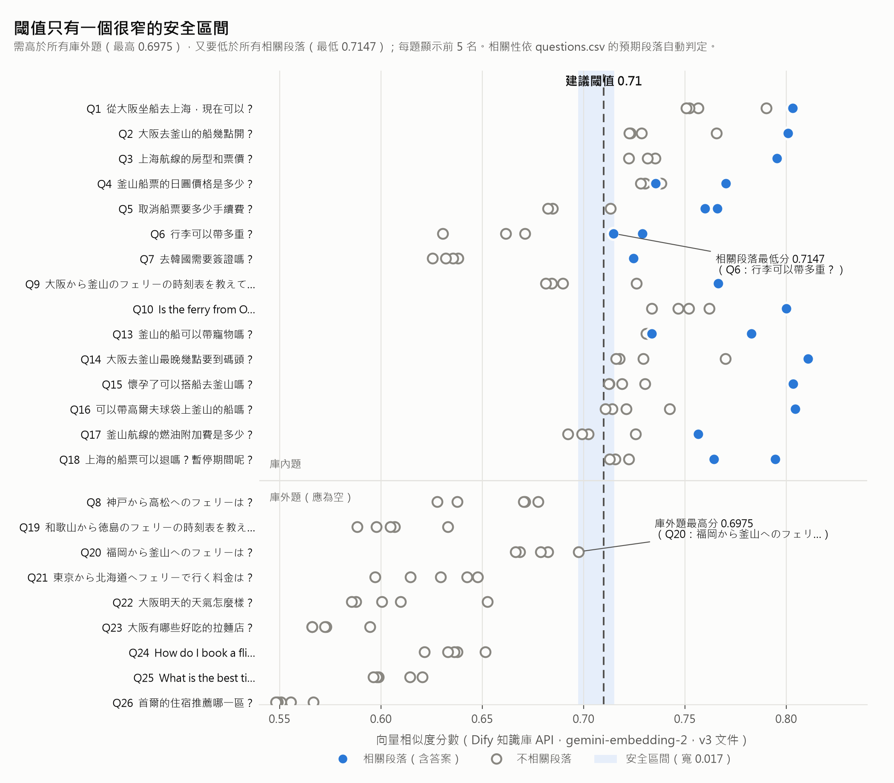
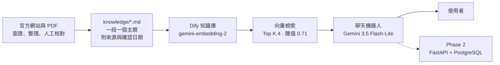

# Japan Ferry KB — 關西出發國際渡輪 RAG 知識庫

以 **Dify Cloud** 建立的「從大阪／神戶出發的國際渡輪」知識庫聊天機器人。重點不只是做出聊天機器人，而是示範：**資料怎麼查證、怎麼整理、怎麼測試、怎麼在資料矛盾或過期時不讓機器人亂答**。

> 日本語版：[README.ja.md](README.ja.md)
>
> **狀態（2026-11-22）**：Phase 1 進行中。知識庫、召回調校、Dify 聊天機器人（Chatflow）、回答層自動測試與金額輸出驗證已完成；剩餘：整理文件。多語言回答只部分改善，已決定延後。

## 目錄

| 想知道… | 跳到 |
|---|---|
| 機器人收到問題後怎麼處理？ | [一張圖看懂回答流程](#一張圖看懂回答流程) |
| 做了哪些發現？ | [這個專案發現了什麼](#這個專案發現了什麼) |
| 資料從哪來、怎麼進知識庫？ | [資料處理架構](#資料處理架構) |
| 機器人遵守哪些規則？有什麼限制？ | [回答規則與已知限制](#回答規則與已知限制) |
| 出過什麼問題、修好了沒？ | [問題處理狀態](#問題處理狀態)（逐條紀錄在 [`docs/issues/`](docs/issues/README.md)） |
| 涵蓋哪些航線？ | [涵蓋的航線](#涵蓋的航線) |
| 檔案放在哪？ | [專案結構](#專案結構) |
| 怎麼自己重做一遍？ | [重現步驟](#重現步驟) |
| 接下來做什麼？ | [Roadmap](#roadmap) |
| 資料可靠嗎？授權？ | [資料聲明與授權](#資料聲明與授權) |

完整分析報告：**[第一階段 RAG 資料稽核與檢索調校報告](docs/phase1-rag-audit-report.md)**。

## 一張圖看懂回答流程



*Dify 編排畫面截圖（已發布版本，2026-11-22），紅色編號是本文加註；畫面上的節點名稱是 Dify 的預設名稱。*

| # | 節點 | 做什麼 | 為什麼這樣設計 |
|---|---|---|---|
| 1 | 開始 → **知識檢索** | 把使用者的問題拿去知識庫做向量檢索，取最相關的 4 段；分數低於 **0.71** 的段落直接丟掉 | 閾值是用 24 題實測校準的，安全區間很窄（[發現 4](#這個專案發現了什麼)） |
| 2 | **條件分支** | 有沒有檢索到段落？有 → 3；沒有 → 4 | 庫外問題不要交給 LLM 自由發揮 |
| 3 | **LLM** | Gemini 3.5 Flash-Lite + 系統提示詞（v5.1），只准依檢索結果回答；「失敗時重試」關閉 | 規則與每條的依據見 [`chatbot/system-prompt.md`](chatbot/system-prompt.md)；重試會造成兩段輸出拼接（[FKB-008](docs/issues/FKB-008-glued-two-generations.md)） |
| 4 | **直接回覆 2** | 固定的三語「知識庫沒有這項資料」訊息，附 3 個可以問的範例 | 這條路**完全不呼叫 LLM**，所以不可能編造；範例問題是為了補救閾值擋掉概括性問題（[FKB-012](docs/issues/FKB-012-overview-questions-miss-threshold.md)） |
| 5 | **程式碼執行** | 金額檢查：找出回答中每個帶貨幣符號的金額，逐一比對檢索結果 | 提示詞只能降低錯價機率，這是不靠模型的把關（[FKB-007](docs/issues/FKB-007-nondeterministic-price-hallucination.md)、[FKB-013](docs/issues/FKB-013-output-amount-guardrail.md)） |
| 6 | **條件分支 2** | 檢查結果 `verdict` 是不是 `pass`？是 → 7；否 → 8 | |
| 7 | **直接回覆** | 顯示 LLM 的回答（含來源與確認日期） | |
| 8 | **直接回覆 3** | 不顯示這個回答，改顯示三語固定訊息：「金額無法與知識庫核對，請再問一次或查官網」 | 寧可不答，也不要給出沒有依據的價格 |

這道金額檢查的效果與限制（詳見 [FKB-013](docs/issues/FKB-013-output-amount-guardrail.md)）：
- 離線：過去 230 則回答只擋下 3 則，正好是已知的 3 個錯價；人造的 524 個錯價全擋。
- 線上：43 次正確回答 0 誤擋。**「擋下」這條路還沒在線上真的觸發過**，所以狀態是 Mitigated，不是 Done。
- 抓不到：金額是真的但配錯艙等；沒有貨幣符號的數字。

## 這個專案發現了什麼

1. **官方資料互相矛盾，不能直接餵給模型。**
   上海航線：官方 2025-12-08 公告旅客運送暫停、再開未定，但官網船班表仍列出到 2027 年 6 月的班次，且不區分載客或貨運。釜山航線：日文與韓文兩個官方網站的退票規定數字不一致。
2. **有價值的資訊藏在 PDF、圖片，甚至頁面原始碼裡。** 票價表的文字層是亂碼，必須轉成圖片目視核對；釜山官網 FAQ 的答案被抓取工具判定為「只有標題」，直接解析原始 HTML 才拿到 62 題完整答案。
3. **向量檢索的分數無法分辨「檔頭／標題」這類沒有答案的段落**（它們最高可達 0.80，和答案段落一樣高），只能靠改文件結構解決；但閾值可以擋住「知識庫沒有的題目」。
4. **檢索閾值要靠實測校準，而且安全區間很窄。** 這個嵌入模型的分數集中在 0.61–0.83，未啟用閾值時所有結果都會通過，常見的中間值（例如 0.5）也擋不住任何東西。用 24 題（含 9 題庫外題）校準後，能同時「不漏掉答案」與「擋住庫外題」的區間只有 0.6975–0.7147（寬 0.017），建議閾值 0.71；語意相近但不在範圍內的問題（例如福岡到釜山）也能拿到 0.70，所以閾值不能是唯一的防線。
5. **改文件結構比調參數有效。** 把文件改成「一段一個主題、標題帶航線標籤、來源寫在段落內」後，15 題有預期答案的題目，相關段落全數排第 1、預期段落 21/21 全部找回，結構性段落從 7/26 降到 0。

6. **回答層要另外測，而且要重複測。** 同一題、同一設定，答案每次都可能不同。用腳本（`evaluation/run_chat.py`）重複呼叫聊天應用 API，再用規則檢查（金額必須出現在檢索結果、禁用語、來源、暫停狀態位置等）。例如：票價回答偶爾把「陽台套房」寫成知識庫沒有的金額（約 4/33 次，[FKB-007](docs/issues/FKB-007-nondeterministic-price-hallucination.md)）；改輸出格式（每艙等一行、人數放價格後面）後 20/20 正確（樣本小，仍是支持證據而非證明）。
7. **「測試設定有沒有真的生效」本身要驗證。** 回答偶爾出現兩段拼接的文字，追蹤 Dify 日誌後發現是 Google 暫時過載 → 節點重試 → 殘缺的前半段被保留（[FKB-008](docs/issues/FKB-008-glued-two-generations.md)）。我們以為已關閉重試，其實只改了草稿、沒有發布；Dify 的 API 跑的是已發布版本。
8. **閾值有代價，用資料補救而不是亂調。** 0.71 的閾值也會擋掉「大阪可以去哪裡」這類概括性問題（[FKB-012](docs/issues/FKB-012-overview-questions-miss-threshold.md)）。解法是新增一個航線總覽段落，並重跑 26 題校準集確認安全區間（庫外題最高 0.6975、相關段落最低 0.7147）沒有改變。



*第一輪（手動、舊版文件）的分數分佈見 [報告 4.3](docs/phase1-rag-audit-report.md)。*

## 資料處理架構



## 回答規則與已知限制

LLM 這一步由系統提示詞的規則決定怎麼回答（完整規則與每條的依據見 [`chatbot/system-prompt.md`](chatbot/system-prompt.md)）：

| 情境 | 回答怎麼做 |
|---|---|
| 航線旅客運送暫停（上海） | 第一句先說明暫停與再開未定，並說明這項資料不代表現在可以購買或搭乘 |
| 兩個官方來源互相矛盾（取消費、報到時間） | 兩套都列出並標明來源，提醒向船公司確認 |
| 問票價 | 每個艙等一行，金額逐字抄自檢索結果，保留原幣別、不換算 |
| 檢索結果沒有寫 | 說沒有，不推測（例如「旺季不能用折扣」不能說成「旺季加價」） |
| 訂票、即時座位、超出範圍 | 說明做不到，並指向官方管道 |

### 已知限制

- 日文、英文提問目前仍常得到中文內容：加入語言規則後，日英單語題的正文語言正確率約 8/20（原本 0/15），三語合一按鈕約 3/15（[FKB-009](docs/issues/FKB-009-answer-language-mismatch.md)，其餘已決定延後；設計選項見 [`docs/multilingual-design-options.md`](docs/multilingual-design-options.md)）。
- 使用 Gemini 免費層，額度與暫時過載會影響測試（[FKB-001](docs/issues/FKB-001-gemini-free-tier-quota.md)）。

## 問題處理狀態

| 狀態 | 數量 | 項目 |
|---|---|---|
| Done | 4 | FKB-002、003、004、012 |
| Mitigated（已有處置，樣本小） | 5 | FKB-001、007、008、010、013（金額輸出驗證，已接進 Dify） |
| Open | 3 | FKB-006（模型比較）、009（多語言，延後）、011（測試工具限制） |
| In Progress | 1 | FKB-005（回答層測試） |

詳見 [`docs/issues/README.md`](docs/issues/README.md)；數字幻覺的處理層級與實例見 [`docs/hallucination-mitigation-options.md`](docs/hallucination-mitigation-options.md)。

## 涵蓋的航線

| 航線 | 營運公司 | 狀態（2026-11-21 確認） | 知識文件 |
|---|---|---|---|
| 大阪 ⇄ 釜山 | PANSTAR Cruise Ferry（日本代理 Sunstar Line） | 官網未見停航公告，無法確認最新班表 | [`knowledge/osaka-busan-panstar.md`](knowledge/osaka-busan-panstar.md) |
| 大阪／神戶 ⇄ 上海 | 日中国際フェリー「鑑真号」 | **旅客運送暫停中**（官方公告），官網班表矛盾 | [`knowledge/kansai-shanghai-shinganjin.md`](knowledge/kansai-shanghai-shinganjin.md) |

另有一份 [`knowledge/overview-routes.md`](knowledge/overview-routes.md) 航線總覽，讓「有哪些航線」這類概括問題能命中。Phase 1 只做這兩條國際航線，國內航線（神戶–高松等）留到第二階段。

## 專案結構

```text
japan-ferry-kb/
├── README.md / README.ja.md
├── LICENSE（程式碼：MIT）、LICENSE-DOCS.md（文件與資料：CC BY 4.0）
├── knowledge/                      知識庫來源文件（持續更新）
│   ├── osaka-busan-panstar.md
│   ├── kansai-shanghai-shinganjin.md
│   ├── overview-routes.md          航線總覽（讓「有哪些航線」這類問題能命中）
│   └── history/                    曾上傳並測試過的舊版本（對應測試紀錄）
├── chatbot/                        Dify 聊天流設定、系統提示詞（含版本）、開場問題、回答層測試題
├── evaluation/
│   ├── questions.csv          測試題、預期行為與預期段落
│   ├── run_recall.py          呼叫 Dify 知識庫 API 跑召回測試
│   ├── score_run.py           自動評分與閾值掃描
│   ├── run_chat.py            呼叫聊天應用 API 跑回答層測試（可重複、限速）
│   ├── score_chat.py          回答層規則檢查（金額溯源、禁用語、來源）
│   ├── chat_runs/             回答層每次測試一個資料夾
│   └── runs/                  每次測試一個資料夾（run-001 手動；run-002 起自動）
│       └── run-00X_日期/      config.json、results.csv、labeled_results.csv、summary.md
└── docs/
    ├── phase1-rag-audit-report.md  稽核與調校報告
    ├── dify-setup.md               Dify 設定與重現步驟
    ├── sources.md                  資料來源與查證紀錄
    ├── coverage-matrix.md          航線 × 主題的資料覆蓋盤點
    ├── hallucination-mitigation-options.md  數字幻覺的處理選項（含本專案實例）
    ├── multilingual-design-options.md       多語言設計選項（已決定延後）
    ├── issues/                     問題與改善紀錄（Jira 格式，FKB-001～）
    └── assets/
        ├── dify-flow.png              Dify 回答流程截圖（本頁最上方，已標註編號）
        ├── threshold-calibration.png  閾值校準圖
        ├── retrieval-scores.png       第一輪（舊版文件）分數分佈
        ├── make_calibration_chart.py  由 run-002／003 產生校準圖
        └── make_retrieval_chart.py    由 run-001 產生第一輪圖
```

## 重現步驟

1. 依 [`docs/dify-setup.md`](docs/dify-setup.md) 設定模型供應商與知識庫（需自備 Gemini API key，**不要提交 key**）。
2. 上傳 `knowledge/` 底下的兩份文件。
3. 用 [`evaluation/questions.csv`](evaluation/questions.csv) 在 Dify「召回測試」逐題檢查，或用 `evaluation/run_recall.py` 自動跑。
4. 依 [`chatbot/app-config.md`](chatbot/app-config.md) 建立聊天流，系統提示詞見 [`chatbot/system-prompt.md`](chatbot/system-prompt.md)；修改後要**按「發布更新」**，API 跑的是已發布版本。
5. 在 `.env` 設定 `DIFY_APP_API_KEY`（參考 `.env.example`），用 `python evaluation/run_chat.py` 與 `score_chat.py` 跑回答層測試。
6. 重畫圖表：`pip install matplotlib && python docs/assets/make_retrieval_chart.py`

## Roadmap

| 階段 | 內容 | 狀態 |
|---|---|---|
| Phase 1 | 知識庫、召回調校、聊天機器人與系統提示、基本評測 | **進行中**（知識庫、召回、聊天機器人、回答層測試已完成；剩完整回歸測試與日文版文件） |
| Phase 2 | FastAPI 串接 Dify API、PostgreSQL、國內航線資料 | 未開始 |
| Phase 3 以後 | 工作流程自動化、人工審核、品質評測、部署 | 未規劃細節 |

## 資料聲明與授權

`knowledge/` 的內容是本專案從營運公司官方網站與公告**整理的摘要**，確認日期見各段落結尾。票價、班次與規定會變動，**可能已過期，不構成訂票或搭乘建議**，請以營運公司官方資訊為準。沒有官方依據的項目一律標示「未取得」，不補編。

授權：程式碼為 [MIT](LICENSE)；文件、知識文件與測試資料為 [CC BY 4.0](LICENSE-DOCS.md)（`knowledge/` 是官方資訊的整理摘要，原始內容的權利屬於各營運公司，見授權說明）。
