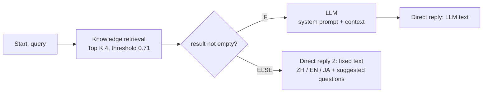

# Dify app configuration (as built; updated 2026-11-22 JST)

| Item | Value |
|---|---|
| App name | `Kansai Ferry Guide｜関西発フェリー案内`（description is trilingual EN/JA/ZH, ≤ 400 chars） |
| App type | Chatflow |
| Model provider | Google Gemini (API key is stored in Dify's model-provider settings, never in this repo) |
| LLM | `gemini-3.5-flash-lite` (free tier). Comparison candidate `gemini-3.8-flash` is not usable for repeated tests on the free tier (20 requests/day), see [FKB-006](../docs/issues/FKB-006-llm-model-comparison-and-billing.md) |
| System prompt | v5.1 deployed, see [`system-prompt.md`](system-prompt.md) |
| Embedding | `gemini-embedding-2` (**do not change**: scores and the 0.71 threshold depend on it) |
| Retrieval | vector search, rerank off, **Top K 4 in the flow's retrieval node** (the DSL says `top_k: 4`; the recall tests used Top K 5), score threshold 0.71 (see the note under "Flow"; the DSL has no threshold field in the node). Knowledge base = `osaka-busan-panstar.md`, `kansai-shanghai-shinganjin.md`, `overview-routes.md` |
| Memory window | off |
| LLM options | Grounding / URL context / Code execution = False (must stay off: answers come only from the knowledge base). Gemini 3 models expose no temperature setting |
| Failed-call retry | **off, and published** (see "Publishing" below and [FKB-008](../docs/issues/FKB-008-glued-two-generations.md)) |
| Opening statement / questions | trilingual greeting plus five buttons, each button holds the zh / en / ja version of one question joined by spaces, see [`opening-questions.md`](opening-questions.md) |

## Flow

Why a branch instead of relying on the prompt alone: an out-of-scope question (Q20, "Fukuoka to Busan") still scored 0.6975 in retrieval,
so the threshold is not a sufficient guard (report §4.5). The ELSE branch never calls the LLM, so it cannot invent an answer.
Out-of-scope questions that do pass the threshold still reach the LLM, so the prompt rules remain the second line of defence.
The ELSE reply also lists three example questions (tested to hit the knowledge base), because a hard threshold blocks vague questions
([FKB-012](../docs/issues/FKB-012-overview-questions-miss-threshold.md)).

### Retrieval settings: what the DSL export shows (checked 2026-11-22)

- The retrieval node's `multiple_retrieval_config` has `top_k: 4`, rerank off, weights = vector only (`vector_weight: 1`, `gemini-embedding-2`). It has **no `score_threshold` field**.
- Evidence that a 0.71 threshold still applies at run time: API runs return 4 chunks for most questions but 3 for some (e.g. A24 in chat-006), and "大阪からどこまでいけますか" (top score 0.6983) goes to the ELSE branch (A35). A node without a threshold would always return 4 chunks.
- So the threshold most likely comes from the knowledge base's own retrieval setting, not from the node. This is **not verified**: open the retrieval node in the editor and check both Top K and the score-threshold switch, and note the result here.
- Consequence: the earlier text of this file ("Top K 5") was wrong for the flow; Top K 5 is what the recall-test scripts sent. Re-importing the DSL elsewhere will not carry the threshold unless the knowledge base has it.

## Publishing (important)

- The editor shows the **draft**; the API and the web app run the **published** version. Changes only take effect after "發布更新" (Publish → Update).
- Publishing sends the **whole draft**, so experimental edits left in the draft go live with the next publish. This happened once: a v5 draft was published together with an unrelated node edit (see `evaluation/chat_runs/chat-009_2026-11-22/NOTE.md`).
- After every publish, confirm the header says "已發布 幾秒前", and keep the prompt version in `system-prompt.md` equal to what is deployed.

## Observed results (details in the report and the issue log)

| Area | Result | Where |
|---|---|---|
| Retrieval | threshold 0.71 verified in the UI and by request (run-005); calibration set re-run after adding the overview chunk, safe interval unchanged (run-008) | report §4.5, §4.8 |
| Wrong prices | prompt v3 (one line per cabin): A1 x20 all correct | FKB-007 |
| Glued output | cause confirmed (Gemini overload, node retry); with retry off and published, 0/20 | FKB-008 |
| Suspension first | prompt v4: A10 x10 and A2 x10 state the suspension first | FKB-010 |
| Overview questions | overview chunk ranks first for general questions; vague Japanese phrasing gets the fixed reply with suggestions | FKB-012 |
| Language | v5.1: Chinese regression 12/12; ja/en body correct 8/20 (was 0/15), closing sentence 20/20; deferred | FKB-009 |
| Cost | about USD 0.002 per request with four chunks (reported by Dify, free tier) | — |

## Still to do

- ~~Export the app DSL~~ Done 2026-11-22: [`kansai-ferry-guide.app.yaml`](kansai-ferry-guide.app.yaml) (exported from the draft; the encrypted dataset ID is redacted; no keys present). Settings confirmed from it: retry off, memory window off, model `gemini-3.5-flash-lite`, prompt v5.1, opening statement and five buttons as in `opening-questions.md`.
- Verify the retrieval node's threshold in the editor (see above) and, if it is missing in the node, set it there so the flow does not depend on the knowledge base's setting.
- Set the memory window (multi-turn is not tested yet, [FKB-011](../docs/issues/FKB-011-eval-harness-limitations.md)).
