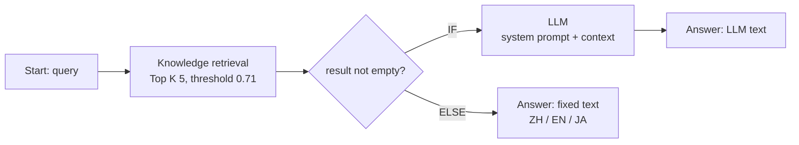

# Dify app configuration (as built, 2026-11-21)

| Item | Value |
|---|---|
| App name | `Kansai Ferry Guide｜関西発フェリー案内`（description is trilingual EN/JA/ZH, ≤ 400 chars） |
| App type | Chatflow |
| Model provider | Google Gemini (API key is stored in Dify's model-provider settings, never in this repo) |
| LLM | Development: `gemini-3.5-flash-lite`. Candidate for comparison: `gemini-3.8-flash` ([FKB-006](../docs/issues/FKB-006-llm-model-comparison-and-billing.md)) |
| Embedding | `gemini-embedding-2` (**do not change**: scores and the 0.71 threshold depend on it) |
| Retrieval | vector search, Top K 5, score threshold 0.71 (on), rerank off |
| Memory window | off (to be set to 10 later) |
| LLM options | Grounding / URL context / Code execution = False (must stay off: answers come only from the knowledge base) |
| Failed-call retry | off or 1 (retries consume free-tier quota, see [FKB-001](../docs/issues/FKB-001-gemini-free-tier-quota.md)) |

## Flow

Why a branch instead of relying on the prompt alone: an out-of-scope question (Q20, "Fukuoka to Busan") still scored 0.6975 in retrieval,
so the threshold is not a sufficient guard (report §4.5). The ELSE branch never calls the LLM, so it cannot invent an answer.
Note that Q20-type questions that do pass the threshold still reach the LLM, so the prompt rules remain the second line of defence.

## Observed so far

- Full-flow preview, "大阪到釜山船票多少錢？": 4 chunks retrieved (scores 0.74–0.77), prices match the knowledge base; two defects found, see [FKB-002](../docs/issues/FKB-002-unsupported-peak-season-surcharge.md) and [FKB-003](../docs/issues/FKB-003-stale-date-rule-not-answerable.md).
- Single-node test with empty context ("你好" / the same fare question): the model answered "the knowledge base has no such data" and did not invent a price.
- Cost per request reported by Dify: about USD 0.0003 (no retrieval) to ~0.002 (with four chunks) on Flash-Lite (estimate for the latter).

## Still to do

Export the app DSL (YAML) into `chatbot/` after the prompt is stable. Check it for dataset IDs and API keys before committing.
