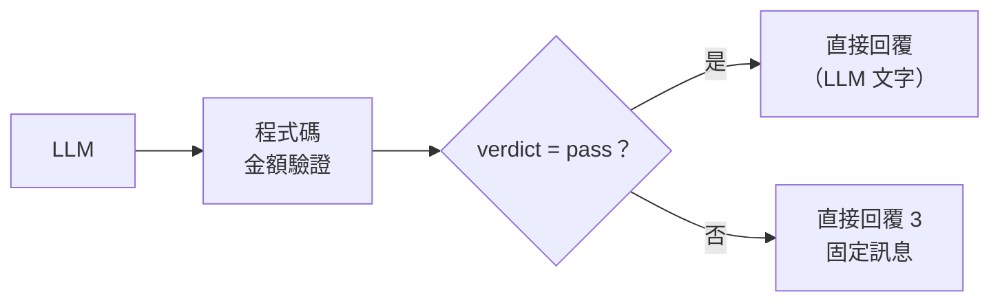

# 金額輸出驗證（guardrail）：接進 Dify 的步驟

目的：LLM 寫出來的金額，如果和檢索到的段落不一致，就**不顯示**，改回固定訊息（[FKB-013](../../docs/issues/FKB-013-output-amount-guardrail.md)）。
這是 [數字幻覺處理選項](../../docs/hallucination-mitigation-options.md) 的層級 3：不靠模型自覺，由程式把關。

## 規則

回答裡每一個「貨幣符號（₩ ¥ ￥）或貨幣單位（韓元、円、日圓、RMB、人民幣、元…）旁邊的數字」，都必須在檢索結果裡以同一個數字、同樣帶貨幣符號出現過。
任何一個對不上 → `verdict = block`。程式在 [`amount_check.py`](amount_check.py)，邏輯與 `evaluation/score_chat.py` 的 `numeric_grounding` 相同。

## 離線驗證結果（2026-11-22，`python evaluation/test_guardrail.py`）

| 測試 | 結果 |
|---|---|
| 重播：12 次測試、230 則回答（其中 93 則含金額） | **3 則會被擋**，正好是已知的 3 個錯價（FKB-007：₩2,500,000 ×2、₩2,000）；其餘含金額的 90 則 **0 誤擋** |
| 注入：把正確金額改成錯誤金額（₩2、₩2,000、₩2,500,000 等）共 524 個變體 | 524/524 全部被擋 |

## 這個檢查抓不到的

- **金額是真的、但配錯艙等**（例如把陽台套房寫成 ₩700,000，而 ₩700,000 是皇家套房的價格）：金額在檢索結果裡，所以會放行。
- **沒有貨幣符號的數字**：人數、百分比、日期、電話、時間。
- 寫成「50萬韓元」之類的中文數字單位。
- 被擋時使用者要自己再問一次；這是止血，不是修正原因（原因的處理見 FKB-007）。

## 在 Dify 裡接線（約 15 分鐘）

目前流程：開始 → 知識檢索 → 條件分支 → LLM → 直接回覆。改成：



1. 編排頁，在 **LLM 節點與「直接回覆」之間的連線**上點 `+`，選 **「程式碼」**。
2. 輸入變數（名稱必須一模一樣）：
   - `answer` ← 選 **LLM → text**
   - `context` ← 選 **知識檢索 → result**
3. 語言選 **Python3**，把 [`amount_check.py`](amount_check.py) 整個內容貼進去。
4. 輸出變數兩個，類型都是 **String**：`verdict`、`bad`。
5. 在程式碼節點後面新增 **「條件分支」**：IF `程式碼 / verdict` **等於** `pass` → 連到原本的「直接回覆」（內容維持 `LLM / text`）；ELSE → 新增 **「直接回覆 3」**，內容貼：

```text
這個回答裡的金額無法與知識庫核對，為避免誤導，已不顯示。請再問一次，或直接查詢官方網站。

The amounts in this answer could not be verified against the knowledge base, so it was not shown to avoid misleading you. Please ask again or check the official website.

この回答に含まれる金額をナレッジベースで確認できなかったため、誤解を避けるために表示を中止しました。もう一度質問するか、公式サイトをご確認ください。
```

6. 用程式碼節點的 **「單步運行」** 測兩組輸入（不用發布）：

| 測試 | answer | context | 預期 |
|---|---|---|---|
| 放行 | `陽台套房 BALCONY SUITE：單程 ₩500,000（客房人數：2 人）` | `\| 陽台套房 BALCONY SUITE \| ₩500,000 \| ₩1,000,000 \| 2 人 \|` | verdict = `pass`，bad = 空 |
| 擋下 | `陽台套房 BALCONY SUITE：單程 ₩2,500,000（客房人數：2 人）` | 同上 | verdict = `block`，bad = `2500000` |

7. 兩組都符合預期，再 **發布更新**（確認顯示「已發布 幾秒前」；草稿裡不要留別的實驗）。

## 接好之後請告訴我

我會用 API 跑：A1 ×20、A3 ×10、A10 ×10、A25 ×3，檢查沒有誤擋（正確回答不應出現固定訊息）。
需要特別看的未知：Dify 在「LLM → 程式碼 → 回覆」的結構下，使用者會不會先看到逐字串流出的未驗證文字（我認為不會，因為回覆節點要等驗證完成，但這是推測，需要在預覽畫面實際觀察）。
