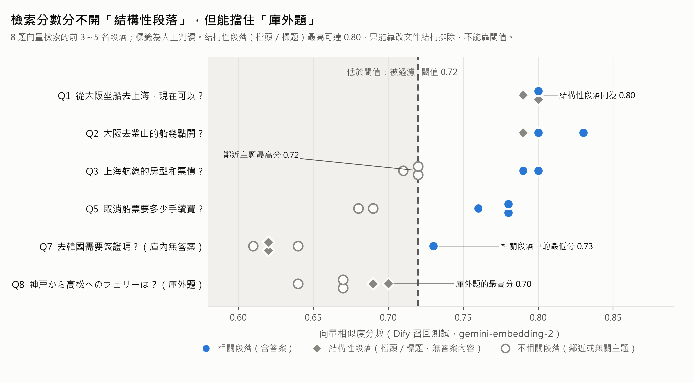
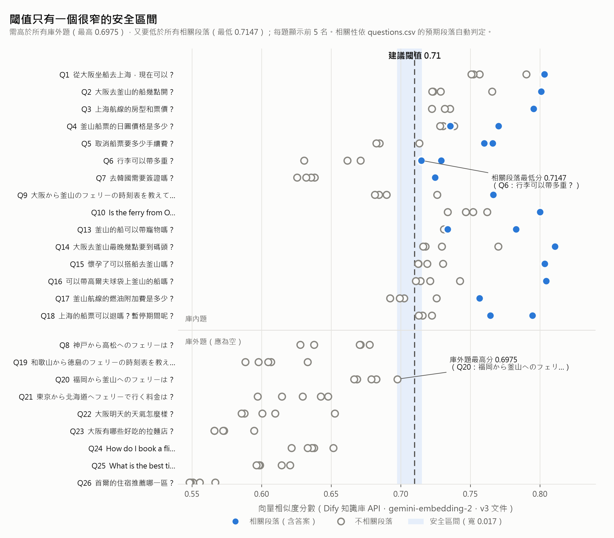

# 第一階段 RAG 資料稽核與檢索調校報告

- **資料確認日期**：2026-11-21
- **範圍**：從大阪／神戶出發的客運國際渡輪（大阪–釜山、大阪／神戶–上海）
- **狀態**：Phase 1 進行中。知識庫已建立並完成第一輪召回測試；聊天機器人尚未建立。
- **本報告的立場**：記錄「做了什麼、發現什麼、為什麼這樣決定、哪些還不確定」。凡是沒有驗證的地方都寫明沒有驗證。

## 1. 摘要

這個題目最大的風險不在模型，而在**資料**：渡輪資訊變動快、來源分散在日文／韓文／中文網站與 PDF，而且官方來源之間會互相矛盾。如果直接把網頁內容丟進知識庫，聊天機器人會很流暢地講出可能已經過期、或根本不確定的票價與班次。

本階段的主要發現：

| # | 發現 | 結論 |
|---|---|---|
| 1 | 上海航線官方公告「旅客運送暫停」，官網班表卻仍列班次 | 文件中如實記錄矛盾，機器人必須先說明暫停狀態 |
| 2 | 釜山航線兩個官方網站的退票規定數字不同 | 兩邊都列出並標明來源，不擅自合併 |
| 3 | 票價與時刻表在 PDF 內，文字層是亂碼 | 轉成圖片目視讀取，並放大核對數字 |
| 4 | 向量分數無法區分「結構性段落」與答案段落 | 改文件結構，不靠閾值 |
| 5 | 分數集中在 0.61–0.83，未啟用閾值時全部通過，常見的中間值（如 0.5）也擋不住；v3 文件下的安全區間只有 0.017 寬 | 先取得完整分佈，再用 24 題校準，建議 0.71 |
| 6 | 改版後的文件在 15 題有預期答案的題目上，**相關段落全數排第 1、預期段落 21/21 全部找回**，結構性段落歸零 | 驗證 v3 的文件結構有效 |

## 2. 範圍與方法

**範圍**：只收官方來源（營運公司網站與公告）；Phase 1 不含國內航線。

**方法**

1. 搜尋找出營運公司官方網站。
2. 平行派出多個 agent 讀取官方頁面（日文、韓文、中文），每個 agent 都要回報「讀到什麼、沒讀到什麼」，沒讀到的標示「未取得」，不得推測。
3. PDF 先擷取文字；文字層失敗時轉成圖片目視讀取，數字再放大核對。
4. 整理成 markdown：每一段一個主題，標題帶航線標籤，段落結尾附來源網址與確認日期。
5. 在 Dify Cloud 建立知識庫，做召回測試，人工標註每個回傳段落是否相關。

**設定**（細節見 [`dify-setup.md`](dify-setup.md)）

| 項目 | 設定 |
|---|---|
| 平台 | Dify Cloud（Sandbox 免費方案） |
| 推理模型 | Gemini 3.8 Flash |
| 嵌入模型 | gemini-embedding-2 |
| 索引 | 高品質，向量檢索，不使用 Rerank |
| 分段 | 常規模式，識別符號 `\n\n`，最大 1500 字，重疊 50 字 |
| 檢索 | Top K 5，Score 閾值 0.71（建議值，由 run-002／003 校準；前兩輪測試時未啟用閾值） |

## 3. 資料稽核發現

| # | 發現 | 影響 | 處理 |
|---|---|---|---|
| F1 | 關西出發的客運國際航線只找到兩條（大阪–釜山、大阪／神戶–上海）。港口管理單位頁面（大阪港頁無日期、神戶市頁 2025-09-08、大阪市頁 404）也只列這兩條 | 範圍比預期小 | Phase 1 只做這兩條。頁面無日期或過期，**不是完整普查** |
| F2 | **上海航線狀態矛盾**：2025-12-08 官方公告旅客運送暫停、再開未定，之後沒有再開公告；但官網運航狀況與 2027 年上半期運航表仍列班次。2025-06 的官方公告說明唯一客船是「鑑真号」、「新鑑真」只做貨運，所以班表中的「鑑真号」航次仍在排，但表上不區分是否載客 | 若只看班表會誤判可以搭乘 | 文件開頭先寫暫停狀態與矛盾，並寫入「回答原則」 |
| F3 | **釜山退票規定兩套**：日文官網約款（2020 年修訂；取消料 10%–30%）與韓文官網（價格頁與 FAQ Q48 兩處一致；3 天前全額退、當天扣 50%）數字不同，官方沒有說明哪套適用 | 機器人只講一套會誤導 | 兩套分開記錄，並註明「兩者不一致，請向購票處確認」 |
| F4 | **票價幣別與時效不一致**：釜山只公布韓元；上海日本出發的日圓票價是 2026 年 1–6 月、且制定於暫停前；上海出發的人民幣票價沒有標示生效期間；兩邊房型名稱不同、對應關係官方未說明 | 容易把舊價當現行價 | 文件註明「暫停前的公布票價」，不自行對應房型 |
| F5 | **資訊藏在 PDF／圖片**：票價改定 PDF 第 2–3 頁文字層為亂碼 | 文字擷取得不到票價 | 轉圖片目視讀取，票價表放大後逐格核對 |
| F6 | **二手摘要出錯**：某次搜尋結果摘要寫成「2026 年 6 月旅客運送再開」，實際是 2025 年 6 月再開、同年 12 月又暫停 | 若採信會把暫停中的航線寫成營運中 | 只採官方頁面原文，不採二手摘要 |
| F7 | **官方頁面本身有過期跡象**：釜山運送約款最後修訂 2020 年；購票說明頁仍出現舊船名；時刻表沒有發布日期；FAQ 答案在抓取時未展開 | 規定可能已變 | 文件標註「可能過時」，缺口列入「已知缺口」段落 |
| F8 | 早先由其他 AI 對話產生的專案草稿，內含國內航線資料，且未經官方查證；範圍也與「國際航線」不符 | 未驗證資料會被機器人當成事實 | **不採用**，改由官方來源重建 |

| F9 | **答案藏在頁面原始碼裡**：釜山官網 FAQ 62 題，抓取工具與 agent 回報「只有標題、答案是摺疊內容」；但原始 HTML 的資料區塊（Next.js 內嵌資料）其實有完整答案 | 若接受「查不到」，會漏掉簽證、寵物、天候、孕婦、行李等關鍵規定 | 直接下載原始 HTML 解析；方法限制寫入 `sources.md` |
| F10 | **釜山報到截止時間有三套說法**：約款與 FAQ「出航前 90 分鐘」；2026-03-30 公告（4/1 起）「發票截止為出航前 1 小時 10 分」；班次頁登船表「大阪出發售票至 16:10（出航前 50 分鐘）」 | 使用者可能因此誤判來得及 | 三種說法並列，建議至少提前 90 分鐘 |
| F11 | **稅金幣別與數字不一致**：日本國際觀光旅客稅 2026-07-01 起由 1,000 円調為 3,000 円；釜山公告已更新，上海官網運賃頁寫 3,000 円，但上海 PDF 與簡報仍寫 1,000 円 | 舊數字會讓總價低估 | 以日本現行規定為準，並註明來源差異 |
| F12 | **FAQ 的簽證答案沒有適用國籍**（韓文網站，推測面向韓國旅客） | 容易被機器人套用到所有國籍 | 文件明寫「未註明國籍，不可套用其他國籍」 |

每份文件末尾都有「已知缺口（不要補編）」段落，列出沒查到的項目（例如釜山日圓票價、燃油附加費金額、簽證規定），讓機器人遇到時能回答「官方資料未提供」。

## 4. 檢索調校發現

### 4.1 分段預覽暴露的問題（第一版文件）

| 問題 | 風險 |
|---|---|
| 票價表和「這是暫停前舊價」的警告被空行切成兩塊 | 檢索只抓到表時，機器人會把舊價當現行價 |
| 多數段落標題沒有航線名（例如「取消與變更」） | 「取消要多少錢」分不出是上海還是釜山 |
| 檔頭資料與標題各自成為獨立段落，沒有答案內容 | 佔用前幾名的檢索名額 |

### 4.2 修正

- **v1**：每個二級標題加航線標籤（例如 `【上海航線｜鑑真号】`）；小於 1,400 字的段落合併成一塊，避免表格與警告被拆開。
- **v2**：移除檔頭與標題段落，改為每段結尾附「來源與確認日期」；合併內容重複的上海取消段落。
- 修正後（v2）：上海 11 塊、釜山 7 塊，每塊都是完整主題，最長約 1,200 字。
- **v3**（補查官網 FAQ、公告、PDF 後）：上海 11 塊、釜山 16 塊，共 27 塊，每塊都在 1,000 字以內，一段一個主題。

### 4.3 第一輪召回測試（手動、v1 文件）

共 8 題（本輪完成 6 題，共 26 個回傳段落，皆由人工標註）。第一輪測試使用的是 **v1 文件**（見 [`knowledge/history/`](../knowledge/history/)），測試條件：Q1、Q2 的 Top K 為 3，其餘為 5；向量檢索；Score 閾值為 0（未啟用），所以回傳的是未經過濾的完整結果。

原始數據：[`../evaluation/runs/run-001_2026-11-21/results.csv`](../evaluation/runs/run-001_2026-11-21/results.csv)

| 標籤 | 數量 | 最低分 | 最高分 |
|---|---|---|---|
| 相關段落（含答案） | 9 | 0.73 | 0.83 |
| 結構性段落（檔頭／標題） | 7 | 0.62 | 0.80 |
| 不相關段落 | 10 | 0.61 | 0.72 |
| 庫外題（Q8）的全部回傳 | 5 | 0.64 | 0.70 |

**判讀**

1. **分數被壓縮**：所有回傳都落在 0.61–0.83，中間值閾值（如 0.5）無法過濾任何結果。第一輪測試是在未啟用閾值（0）的狀態下進行，因此得到完整的分數分佈，可據此校準。
2. **結構性段落分數可高達 0.80**，與答案段落相同，閾值無法排除它們，只能靠改文件結構（v2 已移除）。
3. **庫外題可以被擋住**：Q8（神戶–高松，知識庫沒有）最高分只有 0.70，閾值 ≥ 0.71 就會得到空結果。
4. **Q7（去韓國要簽證嗎）沒有答案**：唯一相關的是「入境相關」段落（0.73），其內容明寫「簽證答案未取得」。這是刻意的設計：機器人能從這段得知「資料庫沒有」，而不是憑模型知識回答。（v3 文件改為收錄 FAQ 的日本簽證說明，並明寫「FAQ 未註明適用國籍、不可套用其他國籍」；Q7 需要用 v3 重測。）

**閾值候選**（由 CSV 計算）

| 閾值 | 損失的相關段落 | 通過的不相關段落 | 通過的結構性段落 | 庫外題 Q8 是否全擋 |
|---|---|---|---|---|
| 0（未啟用，第一輪測試狀態） | 0 | 10 | 7 | 否（5 個通過） |
| 0.50 | 0 | 10 | 7 | 否（5 個通過） |
| 0.70 | 0 | 3 | 4 | 否（1 個通過） |
| 0.72（採用） | 0 | 2 | 3 | **是** |
| 0.73 | 0 | 0 | 3 | 是 |
| 0.74 | **1** | 0 | 3 | 是 |

選 0.72 而非 0.73 的理由是穩健性：0.73 恰好等於最低的相關分數（Q7），差 0.01 就會漏掉該題的唯一答案。代價是有 2 個鄰近主題的段落（Q3 的學生票、已知缺口）會通過，這對回答影響小，可由 LLM 忽略。

### 4.4 對聊天機器人設計的影響

- **空結果**：Q8 這類題目會得到零段落，系統提示必須明寫「沒有檢索到資料就回答知識庫沒有，不得用自身知識回答」，否則模型可能憑印象編造國內航線資訊。
- **航線未指定**：Q5（取消手續費）會同時召回上海與釜山的取消段落。機器人應列出兩邊並標明航線，或先反問使用者。
- **暫停航線**：召回到上海資料時，必須先講暫停狀態。

### 4.5 第二、三、四輪（自動化、v3 文件）

第一輪是在 Dify 畫面手動輸入題目。之後改用 [知識庫 API](https://docs.dify.ai/en/api-reference/knowledge-bases/retrieve-chunks-from-a-knowledge-base-test-retrieval)
腳本化：`questions.csv` 為每題寫明「預期段落」，[`score_run.py`](../evaluation/score_run.py) 依段落標題自動判定相關與否。

| 輪次 | 內容 | 題數 | 閾值 |
|---|---|---|---|
| run-002 | 庫內題（含 Q7 無答案題與 Q8 庫外題）；v3 文件 | 16 | 關閉 |
| run-003 | 8 題庫外題，含容易混淆的近似領域（福岡–釜山、和歌山–德島、航班、天氣、拉麵） | 8 | 關閉 |
| run-004 | 驗證建議閾值 0.71 經由 API 請求參數是否生效 | 4 | 0.71 |
| run-005 | 請求不帶檢索參數，驗證知識庫畫面上設定的 0.71 是否生效 | 4 | 0.71（畫面設定） |

**結果**（run-002，15 題有預期段落）

| 指標 | v3（run-002） | 說明 |
|---|---|---|
| 預期段落找回率 | 21 / 21 | 每題預期的段落全部出現在前 5 名 |
| Hit rate／MRR | 1.0／1.0 | 15 題的第一個相關段落全部排第 1 |
| 結構性段落（檔頭、標題） | 0 | 第一輪 26 筆中有 7 筆 |
| Precision@5 | 0.28 | **不是缺點**：每題只有 1～2 個預期段落，上限就是 0.28（21 個相關 / 75 個名額） |

**閾值重新校準**

| 量 | 數值 | 來源 |
|---|---|---|
| 相關段落最低分 | 0.7147 | Q6 上海行李段落 |
| 庫外題最高分 | 0.6975 | Q20「福岡から釜山へのフェリー」，非關西出發的近似領域 |
| 其他庫外題最高分 | 0.5666–0.6777 | 其餘 8 題庫外題 |
| **安全區間** | **0.6975 – 0.7147（寬 0.017）** | 閾值要落在這裡才能同時「不漏掉答案」與「擋住庫外題」 |

| 閾值 | 損失的相關段落 | 完全找不到相關段落的題數 | 庫外題是否全擋 |
|---|---|---|---|
| 0.70 | 0 | 0 | 是（餘裕僅 0.0025） |
| **0.71（建議）** | **0** | **0** | **是** |
| 0.72 | 1（Q6 上海行李） | 0 | 是 |
| 0.73 | 3 | 2（Q6、Q7） | 是 |

**重要的修正**：第一輪（v1 文件、僅 1 題庫外題）得出 0.72，在 v3 文件與 9 題庫外題下，0.72 會漏掉 Q6 的一個相關段落，且 Q7 唯一的相關段落（0.7247）只剩 0.005 的餘裕。
結論改為 0.71。run-004 以 0.71 實測：Q6 的兩個相關段落、Q7 的簽證段落保留，Q8 與 Q20 回傳空。這同時證明**請求參數裡的閾值會生效**
。run-005 改為請求只帶問題、不帶 `retrieval_model`，結果與 run-004 的分數與段落完全一致（Q6 兩個段落、Q7 一個段落保留，Q8、Q20 為空），**證明知識庫畫面上的 0.71 閾值同樣生效**。
兩者衝突時以誰為準，仍未測試（兩次設定值相同，無法區分）。

**這個結論的脆弱之處**
- 0.71 距離最低相關分只有 0.0047；距離庫外題最高分 0.0125。分數只要因為文件更新、嵌入模型版本變動而位移，這個區間就可能消失。
- Q20 顯示「語意相近但不在範圍內」的問題可以拿到 0.70，閾值**不能是唯一的防線**，系統提示必須要求「無檢索結果即說明知識庫沒有」。
- 閾值 0.71 仍放行大量不相關段落（run-002 共 80 筆中仍有 39 筆不相關的通過），所以 Top K 與系統提示仍需負責忽略它們。
- 每次文件改版都應重跑 run-002／003，重新確認區間。
- 免費方案的知識庫 API 有每分鐘請求上限（實測連續送出約 10 次後回 403）；腳本預設每次間隔 6.5 秒，並在遇到限制時自動等待重試。

### 4.6 聊天機器人首輪回答觀察（預覽、手動，Gemini 3.5 Flash-Lite）

在 Dify 聊天流（知識檢索 → 條件分支 → LLM）中問「大阪到釜山船票多少錢？」：檢索回傳 4 個段落（0.74～0.77），六種艙等的韓元價格與知識庫一致，也標明日圓票價官方未公布。但回答層出現兩個**檢索測試看不到**的缺陷：

| Key | 現象 | 狀態 |
|---|---|---|
| [FKB-002](issues/FKB-002-unsupported-peak-season-surcharge.md) | 把「旺季日不能使用折扣」寫成「旺季加價另計」，知識庫沒有這個結論 | Done（修法已驗證，n=3 + A13） |
| [FKB-003](issues/FKB-003-stale-date-rule-not-answerable.md) | 宣稱「確認日期已超過 3 個月」，但確認日期就是當天；模型拿不到今天的日期 | Done（n=3） |
| [FKB-007](issues/FKB-007-nondeterministic-price-hallucination.md) | 修正後重跑同一題 3 次，其中 1 次出現知識庫沒有的價格「₩2/人」（正確為 ₩500,000） | Open |

提示詞修正後重跑：FKB-002、003 的問題在 3 次重跑與 A13 都沒有再出現；但第 2 次重跑出現了新的價格錯誤（FKB-007），說明單次測試無法看出非確定性的錯誤，需要重複測量與規則式的數字檢查。

這說明檢索層全數通過（Hit rate 1.0）不等於回答可信，兩層必須分開評估。另一個與可用性有關的事件見 [FKB-001](issues/FKB-001-gemini-free-tier-quota.md)（免費層額度用完，錯誤訊息被顯示為「high demand」）。
此外，單步測試中上下文為空時，模型回答「知識庫目前沒有這項資料」而沒有編造價格，這是單題觀察，不能推論到全部題目。完整問題清單見 [issues/README.md](issues/README.md)。

## 5. 設計決策

| 決策 | 理由 | 取捨 |
|---|---|---|
| 只收官方來源 | 渡輪資訊的錯誤成本高 | 覆蓋面較小，部分資訊查不到 |
| 矛盾資訊並列，不合併 | 使用者應知道來源不一致 | 回答較長 |
| 標題帶航線標籤 | 讓檢索片段脫離上下文也能辨識航線 | 標題較冗長 |
| 一段一個主題，段內不留空行 | 避免表格與警告被拆開 | 段落大小不均 |
| 以結構而非閾值排除結構性段落 | 分數無法區分 | 需維護文件格式 |
| 閾值 0.71 | 由 24 題（含 9 題庫外題）校準，並以 API 實測 | 安全區間僅 0.017 寬；每次改版須重測 |
| 以腳本呼叫 Dify 知識庫 API 做測試 | 可重複、可版本化、每次改版成本低 | 需要知識庫 API 金鑰，且受免費方案頻率限制 |
| 不使用 Rerank | 先建立基準，再決定是否需要 | 可能損失排序品質 |
| 缺口寫進文件 | 讓模型知道「查不到」是已知狀態 | 文件含有「不要補編」之類的指示語 |

## 6. 限制

- **樣本小**：召回測試共 24 題（含 9 題庫外題）；庫外題偏少，且多為人工設想的問法，不是真實使用者的提問。
- **標註由單一判讀者完成**，邊界案例（例如 Q2 的「登船手續」是否算相關）具主觀性。
- 第一輪（run-001）使用 v1 文件、手動標註；後續（run-002 起）使用 v3 文件、依預期段落自動判定。兩者的標註方式不同，不應直接比較 Precision。
- **自動標註依賴預期段落的人工設定**；預期段落寫錯會造成誤判，已抽查 run-002 的結果與預期一致。
- 只評估**檢索**，尚未評估**生成**的忠實度與幻覺。
- 只用一個嵌入模型；閾值只對該模型有效。
- 分數只顯示到小數點後兩位，0.72 與 0.73 的差距在顯示精度內。
- **所有資料有時效性**，確認日期 2026-11-21。車輛費用表欄位對應未核實；部分舊年度公告（2025 年）未讀。
- 「只有兩條航線」來自搜尋結果，不是完整普查。

## 7. 下一步

1. ~~上傳 v3 並重測、補測日文與英文問法~~（已完成：run-002～004）。
2. ~~在 Dify 知識庫設定把 Score 閾值設為 0.71，並再驗一次。~~ 已完成，見 run-005。
3. 建立聊天機器人：系統提示包含「無檢索結果即說明知識庫沒有」「暫停航線先講狀態」「矛盾來源並列」「附來源與日期」。
4. 評估**回答**層面：忠實度、幻覺、來源引用是否正確、日文資料能否支撐繁中回答。
5. ~~補查缺口~~（已完成，見 F9–F12）。剩餘缺口見 [`coverage-matrix.md`](coverage-matrix.md)。
6. 第二階段再加入國內航線，並重新校準閾值（資料量增加後分數分佈會改變）。

## 8. 檔案索引

| 檔案 | 內容 |
|---|---|
| [`../knowledge/`](../knowledge/) | 知識庫來源文件（持續更新） |
| [`../knowledge/history/`](../knowledge/history/) | 舊版本；`v1-tested-in-run1` 是第一輪測試實際用的版本 |
| [`../evaluation/questions.csv`](../evaluation/questions.csv) | 測試題與預期行為 |
| [`../evaluation/runs/`](../evaluation/runs/) | 每次召回測試一個資料夾（run-001 手動、run-002～004 自動） |
| [`../evaluation/run_recall.py`](../evaluation/run_recall.py)、[`score_run.py`](../evaluation/score_run.py) | 呼叫 Dify 知識庫 API 的測試與自動評分腳本 |
| [`assets/make_calibration_chart.py`](assets/make_calibration_chart.py) | 由 run-002／003 產生閾值校準圖 |
| [`assets/make_retrieval_chart.py`](assets/make_retrieval_chart.py) | 由 CSV 產生圖表 |
| [`dify-setup.md`](dify-setup.md) | Dify 設定與重現步驟 |
| [`sources.md`](sources.md) | 資料來源與查證紀錄 |
| [`coverage-matrix.md`](coverage-matrix.md) | 航線 × 主題的資料覆蓋盤點 |
